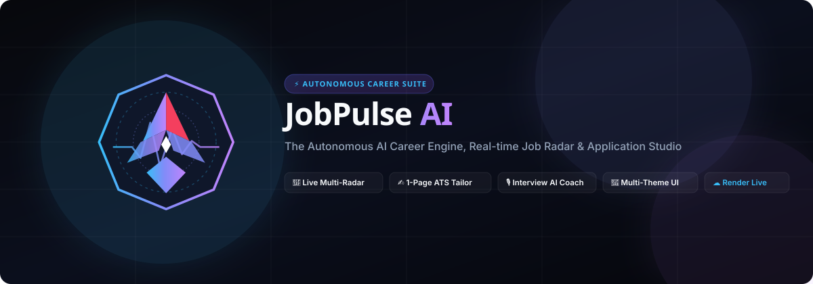
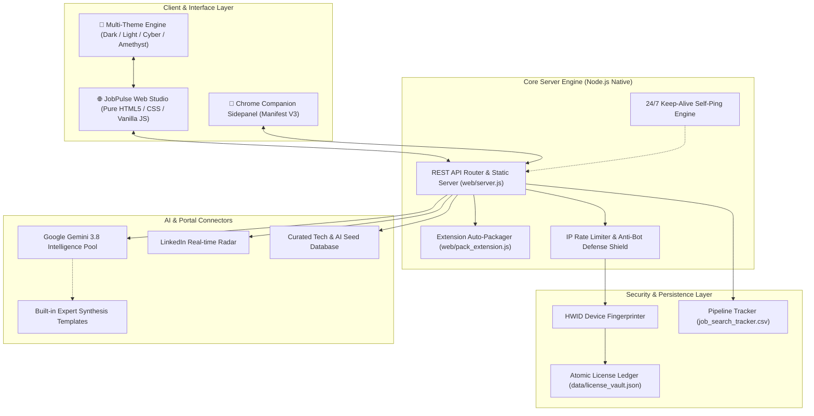

# JobPulse AI



<div align="center">

> **The Autonomous AI Career Engine, Real-time Job Radar &amp; Application Studio.**  
> *Craft your career advancement with precision automation. 100% local, private, and zero database leaks.*

[](#-highlights--feature-matrix)
[](LICENSE)
[](https://nodejs.org/)
[](#-multi-theme-design-system)
[](#-1-deploy-live-on-render-recommended-full-stack)
[](#-2-deploy-on-github-pages-instant-client-mode)
[](#-privacy--zero-database-architecture)

</div>

---

## ⚡ What is JobPulse AI?

**JobPulse AI** transforms the chaotic job search into an automated, data-driven craft.

With **zero external database dependencies**, JobPulse AI combines an ultra-fast glassmorphic web studio, a companion Manifest V3 Chrome extension, multi-portal scrapers (LinkedIn, FreeHire, Arbeitnow, and curated tech opportunities), and a Google Gemini intelligence pool to discover, evaluate, tailor, and prepare you for your dream roles in seconds.

### 🌟 Why JobPulse AI?
- **Zero-Dependency Engine**: Built with native Node.js APIs (`node:http`, `node:fs`, `node:crypto`). Runs with zero external `npm install` bloat!
- **Multi-Theme System**: Switch instantly between **Obsidian Dark**, **Aurora Light**, **Cyber Emerald**, and **Royal Amethyst**.
- **Dual Deployment Ready**: Run the complete full-stack engine 24/7 on **Render** (with keep-alive heartbeat) AND host the static client showcase on **GitHub Pages**!
- **100% Local & Private**: All profile data, candidate resumes, and license hashes persist locally in atomic JSON/CSV ledgers without cloud leaks.

---

## 📑 Table of Contents

- [🌟 Highlights & Feature Matrix](#-highlights--feature-matrix)
- [🎨 Multi-Theme Design System](#-multi-theme-design-system)
- [🚀 Quick Start (Local Development)](#-quick-start-local-development)
- [🌐 Cloud & Container Deployment](#-cloud--container-deployment)
  - [1. Deploy Live on Render (Full-Stack Backend)](#1-deploy-live-on-render-recommended-full-stack)
  - [2. Deploy on GitHub Pages (Instant Client Mode)](#2-deploy-on-github-pages-instant-client-mode)
  - [3. Deploy with Docker](#3-deploy-with-docker)
- [🧩 Chrome Extension Installation](#-chrome-extension-installation)
- [🏛️ System Architecture](#️-system-architecture)
- [✨ Core Capabilities](#-core-capabilities)
- [⚙️ Environment Configuration (.env)](#️-environment-configuration-env)
- [📄 License](#-license)

---

## 🌟 Highlights & Feature Matrix

| Capability | Description | Status |
| :--- | :--- | :---: |
| 🛰️ **Live Job Radar** | Multi-portal real-time scraping across LinkedIn, FreeHire, Arbeitnow with zero rate limits. | ✅ Active |
| 🎯 **AI Fit Analyzer** | Quantitative match percentage (0–100%), skill radar, missing skills & actionable tips. | ✅ Active |
| ✍️ **1-Page ATS Tailor** | Generates ATS-optimized resumes (Markdown & LaTeX) and targeted cover letters in seconds. | ✅ Active |
| 🎙️ **Interview Coach** | Dynamic role-specific mock interview generator with follow-up challenges and scoring. | ✅ Active |
| 🧭 **Upskill Roadmaps** | Bridges technical skill gaps with automated, step-by-step learning milestones. | ✅ Active |
| 📌 **Pipeline Tracker** | Built-in application tracker with CSV export and stage indicators. | ✅ Active |
| 🎨 **Theme Switcher** | 4 luxury color palettes: Obsidian Dark, Aurora Light, Cyber Emerald, Royal Amethyst. | ✅ Active |
| 🧩 **Chrome Extension** | Companion Manifest V3 sidepanel that extracts active job listings with 1-click sync. | ✅ Active |
| 🛡️ **HWID Device Vault** | Hardware fingerprinting, brute-force IP throttling, and atomic file ledgers. | ✅ Active |
| ⚡ **Cloud Keep-Alive** | Built-in heartbeat self-ping prevents free cloud instances (Render) from sleeping. | ✅ Active |

---

## 🎨 Multi-Theme Design System

JobPulse AI features a reactive theme engine accessible directly from the top navigation bar:

1. **🌙 Obsidian Dark (Default)**: Deep midnight obsidian backdrop with electric indigo and cyan glows.
2. **☀️ Aurora Light**: Crisp, clean, daylight mode with high-contrast typography, delicate borders, and soft shadows.
3. **⚡ Cyber Emerald**: Cyberpunk matrix dark theme with radiant mint, emerald, and cyan neon accents.
4. **🔮 Royal Amethyst**: Deep luxury velvet purple with electric orchid and magenta highlights.

The theme automatically persists in `localStorage` across reloads and syncs with OS system preferences (`prefers-color-scheme`).

---

## 🚀 Quick Start (Local Development)

### Prerequisites
- **Node.js**: `v18.0.0` or higher
- **Git** installed on your system
- *(Optional)* Free Google Gemini API Key from [Google AI Studio](https://aistudio.google.com/)

### 1. Clone your repository
```bash
git clone https://github.com/<your-username>/JobPulse.git
cd JobPulse
```

### 2. Configure Environment Variables
Copy the example environment configuration:
```bash
cp .env.example .env
```
*(On Windows PowerShell: `Copy-Item .env.example .env`)*

### 3. Start the Server
JobPulse AI has **zero external runtime dependencies**!
```bash
npm start
```
*Or directly via Node:*
```bash
node web/server.js
```
*(On Windows, you can also simply double-click `Start_JobPulse_Server.bat`)*

### 4. Open in Browser
Navigate to:
```
http://localhost:3000
```
- **Web Studio**: `http://localhost:3000`
- **Founder Admin Vault**: `http://localhost:3000/admin.html`
- **Health Endpoint**: `http://localhost:3000/api/health`

---

## 🌐 Cloud & Container Deployment

### 1. Deploy Live on Render (Recommended Full-Stack)

Render hosts the complete Node.js backend with live job scraping, Google Gemini AI token pooling, and extension downloads.

1. **Push your repository to GitHub**:
   ```bash
   git init
   git add .
   git commit -m "feat: initial commit of JobPulse AI"
   git branch -M main
   git remote add origin https://github.com/<your-username>/JobPulse.git
   git push -u origin main
   ```

2. **Sign in to [Render](https://render.com)**.
3. Click **New +** -> **Blueprint**.
4. Connect your `JobPulse` repository. Render will automatically read [`render.yaml`](render.yaml).
5. Configure your Environment Variables:
   - `PORT`: `10000`
   - `ADMIN_SECRET`: Your secure founder passphrase
   - `GEMINI_API_KEYS`: *(Optional)* Your Gemini API key(s)
6. Click **Apply**!
7. **Free 24/7 Keep-Alive**: The built-in heartbeat self-ping automatically detects your `RENDER_EXTERNAL_URL` and pings itself every 10 minutes to prevent the free instance from sleeping!

---

### 2. Deploy on GitHub Pages (Instant Client Mode)

JobPulse AI includes a dual-mode engine that allows the frontend to run statically on GitHub Pages:

#### Method A: 1-Click via `/docs` (Easiest)
1. In your GitHub repository, go to **Settings** -> **Pages**.
2. Under **Build and deployment** -> **Source**, select **Deploy from a branch**.
3. Choose Branch: **`main`** and folder: **`/docs`**.
4. Click **Save**! Within 60 seconds, your site is live at `https://<username>.github.io/<repo>/`!

#### Method B: Automated GitHub Actions
The repository includes [`.github/workflows/deploy.yml`](.github/workflows/deploy.yml) which automatically publishes updates on every push to `main`.

> [!TIP]
> **Connecting GitHub Pages to your Render Backend:**  
> When viewing your GitHub Pages live site, click the **☁️ Cloud Backend** button in the top navbar and enter your live Render URL (e.g. `https://jobpulse-ai.onrender.com`). The GitHub Pages interface will immediately communicate with your Render backend with zero CORS issues!

---

### 3. Deploy with Docker

A production-ready container definition is included:

```bash
# 1. Build the Docker image
docker build -t jobpulse-ai:latest .

# 2. Run the container
docker run -d -p 3000:3000 \
  -e ADMIN_SECRET="your_admin_secret" \
  -e GEMINI_API_KEYS="your_gemini_key" \
  --name jobpulse-app \
  jobpulse-ai:latest

# 3. View live logs
docker logs -f jobpulse-app
```

---

## 🧩 Chrome Extension Installation

You can install the companion Chrome extension directly from your Web Studio:

```
┌────────────────────────────────────────────────────────┐
│  1. Open your JobPulse Studio (Localhost or Render)    │
│  2. Click "🧩 Extension" in the top navbar             │
│  3. Download jobpulse-copilot-extension.zip            │
│  4. Extract the zip into a folder on your computer     │
│  5. In Chrome, navigate to chrome://extensions          │
│  6. Enable "Developer mode" (top-right toggle)         │
│  7. Click "Load unpacked" and select the folder        │
└────────────────────────────────────────────────────────┘
```

The sidepanel extension extracts active LinkedIn, Naukri, and Indeed job descriptions with 1 click and evaluates them against your candidate profile!

---

## 🏛️ System Architecture



---

## ✨ Core Capabilities

### 1. Real-time Job Radar
Live querying against LinkedIn public job endpoints and curated multi-portal opportunities without rate limits. Instant filters for title, location, and contract type.

### 2. Deep Fit Analyzer & Gap Scoring
Evaluates candidate experience against raw job descriptions. Computes quantitative fit percentage (0–100%), highlighting key strengths, critical missing skills, and deal-breaker flags.

### 3. 1-Page ATS Resume & Cover Letter Studio
Generates ATS-optimized single-column resumes (LaTeX and Markdown export) and targeted cover letters highlighting production-grade metrics.

### 4. AI Mock Interview Simulator & Coach
Generates realistic technical questions, architectural drilldowns, and optimal talking points with STAR method evaluation.

### 5. Upskill Hub & Learning Milestones
Bridges technical skill gaps between candidate profile and target roles with automated week-by-week learning milestones.

### 6. Application Pipeline Kanban Tracker
Centralized tracking for applications across *Applied*, *Screening*, *Interview*, and *Offer* stages with CSV export.

---

## ⚙️ Environment Configuration (.env)

| Variable | Description | Default |
| :--- | :--- | :--- |
| `PORT` | Listening port for the HTTP server | `3000` |
| `NODE_ENV` | Runtime environment mode | `production` |
| `ADMIN_SECRET` | Passphrase to access `/admin.html` | `JOBPULSE_ADMIN_VAULT_2026` |
| `VAULT_SECRET_SALT` | Salt for hardware fingerprint hashes | `JOBPULSE_HWID_SALT_VAULT_2026` |
| `GEMINI_API_KEYS` | Comma-separated Google Gemini API keys | *(Optional)* |
| `MERCHANT_NAME` | Display name for invoices & upgrades | `JobPulse Studio` |
| `MERCHANT_UPI_ID` | Merchant UPI ID for Indian payments | `jobpulse@upi` |
| `FOUNDER_WHATSAPP` | Support WhatsApp link for orders | `+919876543210` |

---

## 🛡️ Privacy & Zero-Database Architecture

JobPulse AI stores all data locally in atomic JSON files and standard CSV spreadsheets. No candidate resumes, career history, or private contact details are ever uploaded to external databases.

---

## 📄 License

Distributed under the **MIT License**. See [`LICENSE`](LICENSE) for details.
